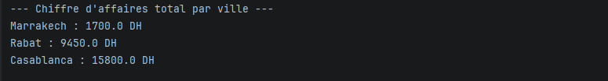
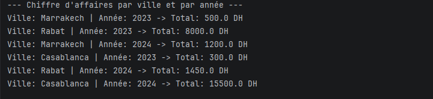
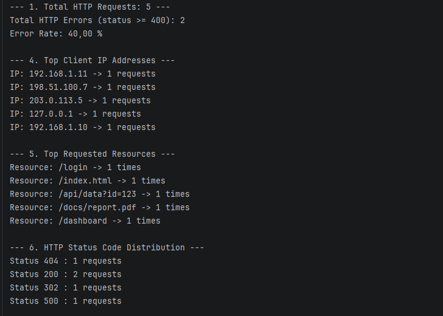

# Apache Spark RDD Lab (Java & Maven)

This repository contains practical exercises implementing Big Data processing workflows using **Apache Spark RDDs** in **Java 17** and **Maven**.

## Environment & Prerequisites

- **Java Development Kit (JDK):** 17
- **Apache Spark:** 3.5.5
- **Build Tool:** Maven
- **IDE:** IntelliJ IDEA

> **Note for Java 17 users:** add the following JVM option (Run > Edit Configurations > VM options) to bypass the internal access restrictions required by Spark:
>
> ```text
> --add-exports=java.base/sun.nio.ch=ALL-UNNAMED
> ```

---

## Input Files

Both input files are plain text files located at the root of the project and are read from the local file system.

### `ventes.txt` (Exercise 1)

Sales transactions recorded by a company in several Moroccan cities (Casablanca, Rabat, Marrakech) over the years 2023 and 2024. Each line is one transaction, with fields separated by a space:

```text
date city product price
```

| Field     | Description                                   |
|-----------|-----------------------------------------------|
| `date`    | Date of the transaction (the year is extracted from it in Part 2) |
| `city`    | City where the sale occurred                  |
| `product` | Name of the product sold                      |
| `price`   | Price of the product, in DH                   |

### `access.log` (Exercise 2)

Access log of an Apache web server. Each line is one HTTP request sent by a client, in the following format:

```text
IP - user [date:time timezone] "METHOD URL PROTOCOL" HTTP_STATUS SIZE "REFERER" "USER-AGENT"
```

Example line:

```text
127.0.0.1 - - [10/Oct/2025:09:15:32 +0000] "GET /index.html HTTP/1.1" 200 1024 "http://example.com" "Mozilla/5.0"
```

| Field        | Description                                         |
|--------------|-----------------------------------------------------|
| `IP`         | Client IP address                                   |
| `user`       | Authenticated user (`-` if anonymous)               |
| `date:time`  | Date and time of the request, with timezone         |
| `METHOD`     | HTTP method (GET, POST, ...)                        |
| `URL`        | Requested resource (e.g. `/index.html`)             |
| `PROTOCOL`   | HTTP protocol version                               |
| `HTTP_STATUS`| HTTP response status code (200, 302, 404, 500, ...) |
| `SIZE`       | Response size in bytes                              |
| `REFERER`    | Referrer page (`-` if none)                         |
| `USER-AGENT` | Client software used to send the request            |

The file contains 5 sample requests covering the status codes 200, 302, 404 and 500.

---

## Exercise 1: Sales Analysis Using Spark RDDs

This exercise processes the sales transactions of `ventes.txt` to compute revenue aggregations.

### Part 1: Total Sales by City

Calculates the total sales amount for each city (class `TotalSalesByCity`).



### Part 2: Sales Analysis by City and Year

Extracts the city and the year from each transaction and computes the total sales grouped by both (class `TotalSalesByCityAndYear`).



---

## Exercise 2: Web Server Log Analysis Using Java RDDs

This exercise processes the Apache access log `access.log` using Spark RDD transformations and actions to extract operational statistics (class `LogAnalysis`): total requests, error count and rate, top 5 client IPs, top 5 requested resources and the HTTP status code distribution.



---

## How to Run

1. Clone the repository:

   ```bash
   git clone https://github.com/Salma-Majri/Apache-Spark-RDD-Lab.git
   ```

2. Open the project in IntelliJ IDEA and reload Maven.
3. Make sure `ventes.txt` and `access.log` are in the project root directory.
4. Run any exercise class (`TotalSalesByCity`, `TotalSalesByCityAndYear` or `LogAnalysis`) with the VM option above configured.